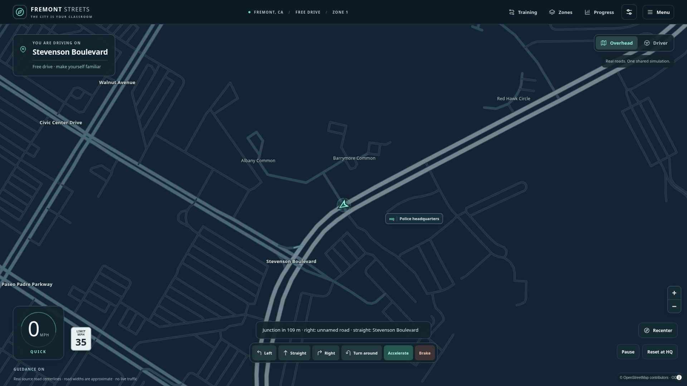
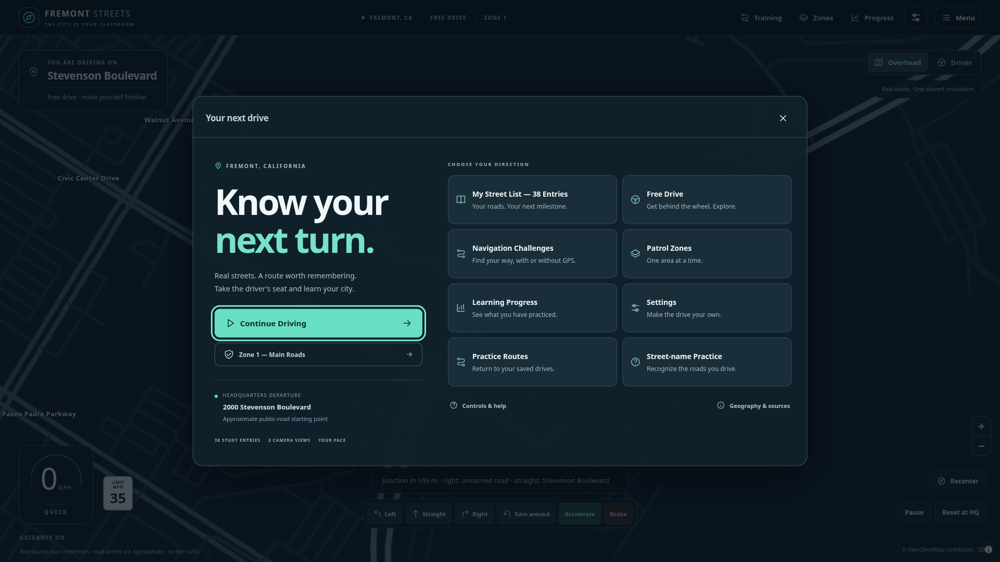

# Fremont Streets — AFTER screenshots

Captured from the production build served under `/fremontStreets/` using
Chromium. Desktop captures are 1920×1080; the laptop capture is 1280×800.
They show the actual game with its bundled source-backed roads and browser-local
state. Initial and refined captures were inspected during implementation.

| Screen | Capture |
|---|---|
| Main menu | [01-main-menu.png](01-main-menu.png) |
| Full-viewport overhead driving | [02-overhead-driving.png](02-overhead-driving.png) |
| Driver's seat and generic vehicle interior | [03-drivers-seat.png](03-drivers-seat.png) |
| Personalized street selection | [04-personal-street-selection.png](04-personal-street-selection.png) |
| Navigation challenge | [05-navigation-challenge.png](05-navigation-challenge.png) |
| Learning dashboard | [06-learning-dashboard.png](06-learning-dashboard.png) |
| Driving and display settings | [07-settings.png](07-settings.png) |
| Smaller desktop driving view | [08-laptop-driving.png](08-laptop-driving.png) |

The user-provided BEFORE screenshot had permanent side columns and a smaller
central map. The redesigned driving surface occupies approximately 93.7% of a
1920×1080 viewport with panels closed. Menus and learning controls are separate
from the driving HUD.

Road widths, flat 3D surfaces, sky and cockpit are visual approximations. These
screenshots do not establish real lane geometry, bridge heights, traffic rules
or full-city coverage. See [the redesign report](../redesign.md) and
[geographic limitations](../personalized-geography.md).
